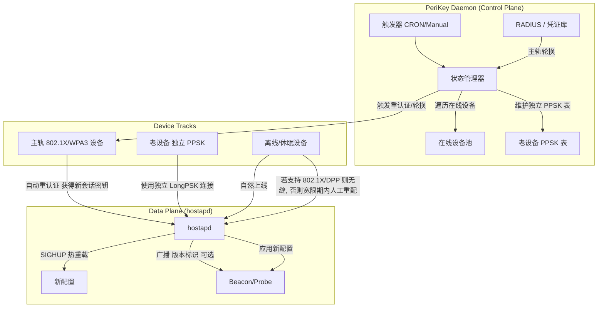
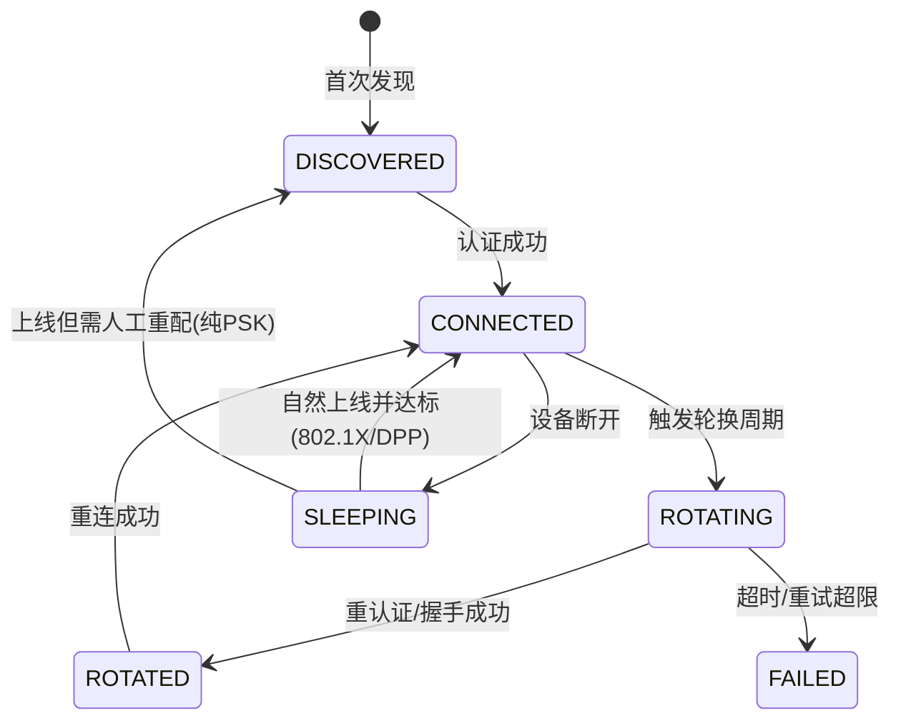

# PeriKey v0.6 · 家庭 Wi-Fi 密钥管理架构（RFC 草案 · 诚实版）
**Key Management for Home Wi-Fi — Strict RFC, Honest Security Claims**  
*State-Driven. Zero-Client-Overhead where the standard allows it. Isolation for the rest.*

**Status**: RFC Draft (Design Only — no reference implementation yet)  
**License**: MIT  
**Target Platform**: OpenWrt (Embedded Linux)  
**Version**: 0.6.0 (Aligned with project's two hard constraints)

---

## 0. 本文件地位
这是 PeriKey 项目的**权威说明文件（RFC 草案）**。所有协议细节不得突破第 1 节列出的两条硬约束。后续实现（Phase 1 原型及以后）以此为基准，不得擅自引入"设备侧改造"或"主动唤醒离线设备"机制。

---

## 1. 范围与不可推翻的前提 (Scope & Non-Negotiable Constraints)

项目源于用户核心痛点：**不换密码 → 易被破解；手动换密码 → 每台设备都要重配，运维成本极高。**
为把方案收敛到可落地，以下四条为设计硬约束，任何协议细节不得突破：

| # | 约束 | 含义 |
| :--- | :--- | :--- |
| ① | **只服务在线设备** | 密钥分发（握手）仅对轮换时刻**处于在线状态**的设备执行。离线/休眠设备**不在主动服务范围内**，不得设计"广播唤醒/主动推送"机制。 |
| ② | **设备零改造** | 不得依赖任何需要设备侧安装的软件：`wpa_supplicant` 插件、PeriKey 客户端代理等一律 **不在方案内**。仅可使用设备**原生已支持**的标准能力（802.1X、DPP/Wi-Fi Easy Connect）。 |
| ③ | **"无感轮换"有前提** | 自动、无缝的密钥轮换，仅对**原生支持 802.1X / DPP** 的设备成立（属标准能力，非附加功能）。其余设备走隔离或人工重配轨道。 |
| ④ | **诚实安全模型** | 纯 PSK 老设备采用 AP 侧**独立长 PPSK、不参与主密码轮换**；其安全模型是"与主网**隔离**"，**不得声称免疫离线爆破**。 |

> **关键认知（贯穿全文）**：在 802.11 协议下，PSK 是 AP 与设备双方持有的对称秘密。要更换它，必须双方都学到新值。因此——
> - **"不给设备加任何功能，又自动给纯 PSK 设备换密码"在物理上不可能。**
> - 唯一"零设备改动 + 自动轮换"的轨道是 **802.1X/RADIUS**：客户端用身份凭证登录，服务器侧轮换、客户端自动重认证，**根本没有"推 PSK"这一步**。
> - PSK 推送方案（Flow B）本质上需要设备运行客户端，**违反约束②**，本草案仅作为"若未来放松约束②"的备选附录列出。

---

## 2. 设计原则对照

| 维度 | 过度设计方案 | **PeriKey v0.6（本草案）** |
| :--- | :--- | :--- |
| 在线设备轮换 | 主动握手分发新 PSK | ✅ **主轨 802.1X/RADIUS**：服务器侧轮换，客户端自动重认证，**零改动、真无感** |
| 离线/休眠设备 | 广播唤醒/推送 | ✅ **静默等待**：不主动唤醒；仅在其**自然上线**时按标准能力处理 |
| 设备侧改造 | 装 App/插件/代理 | ✅ **零改造**：仅用设备原生 802.1X / DPP 能力 |
| 老设备兼容 | 强行降级或复杂协商 | ✅ **独立隔离**：AP 侧独立长 PPSK，设备侧零改动，**物理隔离**主网风险 |
| 安全声称 | "抗离线爆破" | ✅ **诚实定义**：缩短**有效窗口** + **PFS**（仅 802.1X/WPA3）+ **单点隔离**（PPSK） |

---

## 3. 系统架构与状态机

### 3.1 逻辑拓扑


### 3.2 设备状态机（仅在线设备定义复杂状态）


---

## 4. 密钥轮换机制（分轨道）

### 4.1 主轨：802.1X / RADIUS（零设备改动，真正无感）★ 推荐
*适用范围：原生支持 WPA3-Enterprise / 802.1X 的设备（多数现代手机、笔记本、部分 IoT 网关）。*

1. 设备使用**固定的身份凭证**（初始入网时通过 DPP 扫码或一次配置完成，**无需打字、无需 PeriKey 客户端**）登录 RADIUS。
2. 每次连接，AP 与设备基于凭证派生**每会话独立**的 PMK/PTK；密钥不在设备侧长期存储为"PSK"。
3. **轮换 = 服务器侧动作**：定期更换 RADIUS 共享密钥 / 缩短重认证周期。设备下一次重认证即用新会话密钥。
4. 设备侧**完全无感、零改动**，且满足约束②③。

> 这是本草案在"零设备改造"前提下**唯一成立**的自动无缝轮换轨道。

### 4.2 备选轨：PSK 推送（⚠ 需放松约束②）
*仅当未来决定允许在设备上部署 PeriKey 客户端时代入。当前草案不采用。*

1. Daemon 向**当前在线**且运行客户端的设备发 `MSG_INIT`。
2. 双方推导 `SessionKey`，Daemon 用其加密 `NewPSK` 下发。
3. `hostapd` SIGHUP 热重载，设备用缓存的 `NewPSK` 重连。
> 此轨依赖设备侧代理，**违反约束②**，故不在主方案内。

### 4.3 离线 / 回归设备：静默等待 + 自然上线
*严格遵守约束①：不主动广播唤醒、不主动推送。*

1. 设备断开后标记为 `SLEEPING`，**不再主动联系**。
2. 设备因自身业务（定时任务/用户操作）**自然上线**。
3. **分支判定**：
   - 若设备原生支持 802.1X/DPP → 走 4.1 / DPP 重配，**无缝**。
   - 若为**纯 PSK 且无客户端**设备 → 在 **Grace Period（宽限期，建议 24h）** 内可用 `OldPSK` 回连；但因其**无法接收新 PSK**，宽限期结束后 `OldPSK` 被 AP 撤销，设备将**断开且需人工重配**（DPP 扫码 / WPS / 重输）。文档明确此失败路径，不假装自动恢复。

### 4.4 老设备轨：独立 PPSK 隔离（零改动）
*适用范围：固件不支持 802.1X/DPP 的纯 WPA2 PSK 老 IoT。*

1. AP 侧为每台老设备维护独立 `LongPSK_i`（长度 ≥ 16、高熵随机），存于 `wpa_psk_file` 独立条目。
2. 老设备始终用 `LongPSK_i` 连接，**不参与**主网轮换逻辑（轮换周期可设 1 年或更长）。
3. **安全模型（诚实）**：
   - 主网被破 → 老设备独立安全（密钥隔离）。
   - 老设备被破 → 主网独立安全（单点隔离）。
   - 抗爆破依靠 `LongPSK_i` **高熵**而非动态轮换；属"隔离降级"，**非免疫**。

---

## 5. 诚实威胁模型 (Honest Threat Model)

| 威胁场景 | 传统 WPA2 共享 PSK | **PeriKey v0.6** |
| :--- | :--- | :--- |
| 离线爆破 (Offline Dictionary) | 高：捕获握手包可长期爆破，且一破全崩 | **窗口截断**：主轨靠 802.1X 每会话密钥 + PFS；老轨靠长 PPSK 高熵 + 隔离。轮换缩短"已泄露密钥有效寿命"，**不使离线爆破不可能**。 |
| 在线嗅探 (Online Sniffing) | 中：入网后可监听 | 主轨：逐会话独立密钥，单设备泄露不波及；老轨：隔离，单点泄露不波及主网。 |
| 老旧设备风险 | 低隔离：混用弱加密 | 高隔离：独立 PPSK 轨道，主/老互不影响。 |
| 前向保密 (PFS) | 弱：长期密钥泄露可重放历史 | **仅 802.1X/WPA3 轨道具备真 PFS**；纯 PSK 老轨**无 PFS**，靠长密钥 + 隔离缓解。 |

> **明确修正**：不再声称"轮换使离线爆破不可能"。准确说法：轮换**缩短已泄露密钥的有效生命周期**；真正抗爆破依赖 **802.1X PFS** 与 **每设备 PPSK 隔离**。

---

## 6. 协议帧格式 (Fixed Header + HMAC)

*修正确认：Nonce 为 64-bit（8 字节）；校验由 CRC32 升级为 HMAC-SHA256 以抗主动篡改。*

| 字段 (Offset) | 名称 | 长度 | 说明 |
| :--- | :--- | :--- | :--- |
| 0-1 | Magic | 2 | `0x504B` (PeriKey) |
| 2-3 | Version | 2 | 协议版本 (当前 0.6) |
| 4-11 | Nonce | 8 | 64-bit 随机数，**防重放**（须配合单调计数器或滑动窗口校验唯一性） |
| 12-15 | Flags | 4 | 标志位 (`ASYNC`, `REAUTH` 等) |
| 16-19 | Payload Len | 4 | 负载长度 |
| 20-... | Payload | Var | 业务数据（如加密后的 NewPSK，JSON 或二进制） |
| ... | HMAC | 16 | **HMAC-SHA256**，密钥为 `KDF(DSecret)` 或本次 `SessionKey`；覆盖前述全部字段以抗篡改 |

- **重放防护**：除 Nonce 外，接收方须维护已见 (Nonce, Counter) 集合或滑动窗口，丢弃重复/过期帧。
- **完整性**：HMAC 替代 CRC32，攻击者无法在不知密钥下伪造或篡改 Payload。

---

## 7. OpenWrt 集成与实现路径

### 7.1 守护进程 (`perikyd`)
- **启动**：`systemd` / `procd` 服务，定时器触发（如 `@daily`）。
- **配置**（UCI，`/etc/config/perikyd`）：
  ```bash
  config perikey
      option rotation_interval '2592000' # 主轨轮换周期 30 天
      option grace_period     '86400'   # 宽限期 24 小时
      option legacy_ppsk      '1'       # 启用独立 PPSK 隔离轨
      option main_track       'radius'  # 主轨: radius(802.1X) | psk-push(需放松约束②)
  ```
- **日志**：`/var/log/perikyd.log`，记录状态变更与失败重试。

### 7.2 与 hostapd 交互
- **动态 PSK / PPSK**：直接修改 `wpa_psk_file`，执行 `kill -HUP $(pidof hostapd)` 热重载。
- **多 SSID**：各 SSID 维护独立设备映射表（主轨 SSID 跑 802.1X，老轨 SSID 跑独立 PPSK）。

### 7.3 主轨 RADIUS（零设备改动的关键）
- 主轨 SSID 配置为 WPA3-Enterprise，后端对接 RADIUS（如 `freeradius`）。
- `perikyd` 定期轮换 RADIUS 服务端密钥 / 下发重认证指令；客户端自动重认证，**无需任何设备侧软件**。

---

## 8. 演进路线图 (Roadmap)

| 阶段 | 目标 | 交付物 |
| :--- | :--- | :--- |
| Phase 1 | 逻辑闭环 | Python 原型：模拟 802.1X 主轨重认证 + 老轨 PPSK 隔离 + 离轨回归判定（**不含广播唤醒**） |
| Phase 2 | OpenWrt 落地 | 编译 `perikyd`；集成 UCI；对接 hostapd `wpa_psk_file` 与 RADIUS 热重载 |
| Phase 3 | 生态兼容 | 完善 DPP 扫码重配流程（供离轨/老轨人工无痛重配使用） |
| Phase 4 | 固件打包 | 集成至 OpenWrt 镜像，提供 Web UI 配置向导 |

---

## 9. 快速验证 (Quick Start)

```bash
# 1. 克隆仓库
git clone https://github.com/example/perikyd.git
cd perikyd/prototype

# 2. 运行演示（预期输出基于严格逻辑，不虚构 Beacon 广播 PSK）
python3 demo.py
# [INFO] Controller initialized...
# [INFO] Main-track Device_A (802.1X) -> trigger re-auth, new session key issued...
# [INFO] Legacy Device_C (PPSK) connected with isolated LongPSK_i...
# [INFO] Sleep Device_B sleeping -> no active wake (constraint ①)...
# [INFO] Device_B natural wake -> 802.1X re-auth OK / or Grace-Period manual re-provision required
```

---

## 10. 结论

**PeriKey v0.6** 是一份**自洽、诚实的设计草案**，不存在参考实现。它用一条清晰的边界解决了用户的原始困境：

- **能自动无缝轮换的设备**（原生 802.1X/DPP）→ 主轨服务器侧轮换，零改动、真无感；
- **不能轮换的纯 PSK 老设备** → AP 侧独立长 PPSK 隔离，同样**永不需人工重配**，代价是该隔离段靠高熵 + 隔离缓解风险，而非动态轮换；
- **任何设备都不再需要"换密码时逐台重连"**——这正是痛点本身的解法。

本草案**拒绝**以下过度声称：轮换使离线爆破不可能、纯 PSK 设备可无感自动轮换、需设备安装客户端。这些在 802.11 协议与现实约束下均不成立。

下一步是将逻辑转化为 OpenWrt 上的 `perikyd` 守护进程并对接 RADIUS，让普通用户在不改动任何现有设备的前提下，获得企业级的密钥管理能力。

---
*PeriKey: Security that adapts to your life, not the other way around.*
